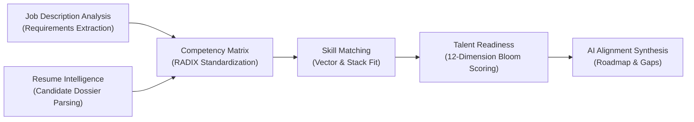

# Alohomora — Autonomous Talent Intelligence Platform

[](frontend/)
[](backend/)
[](https://supabase.com)
[](LICENSE)

**Alohomora** is an enterprise-grade talent intelligence platform engineered with a dark, cinematic Netflix-inspired UI design. It delivers end-to-end autonomous candidate calibration: from parsing unstructured job descriptions and resumes to multidimensional Bloom taxonomy scoring against authoritative enterprise benchmarks.

---

## Architecture & End-to-End Pipeline

Alohomora connects four autonomous intelligence stages into one continuous workflow:



1. **Job Description Intelligence**: Accepts PDF, DOCX, or direct plaintext job descriptions. Extracts 12 RADIX competency pillars, required Bloom taxonomy seniority levels, and tech stacks.
2. **Resume Intelligence**: Parses unstructured resumes, extracts verified professional trajectories, and normalizes candidate skills into Bloom proficiency tiers (1–10).
3. **Candidate Pool Directory**: High-density searchable directory with telemetry diagnostics, department/seniority filters, and an interactive slide-over dossier inspector.
4. **Talent Readiness Assessment**: Connects to 118 enterprise benchmarks stored in Supabase (1,356+ verified requirement rows), computes deterministic readiness percentages across all 12 RADIX categories, and generates an AI explanation layer with 30-60-90 day ramp roadmaps and project recommendations.
5. **Skill Match & History**: Side-by-side alignment matrix and persistent audit log archive.

---

## Project Structure

```text
Radix-Talent-Match-main/
├── frontend/                     # React + Vite application
│   ├── src/
│   │   ├── components/
│   │   │   └── Header.jsx        # Alohomora top navigation & session status
│   │   ├── pages/
│   │   │   ├── Home.jsx          # Editorial hero & workspace cards
│   │   │   ├── JDIntelligence.jsx# Job Description analysis workspace
│   │   │   ├── ResumeIntelligence.jsx # Resume extraction workspace
│   │   │   ├── Candidates.jsx    # Candidate directory & slide-over drawer
│   │   │   ├── TalentReadiness.jsx # Supabase benchmark assessment
│   │   │   ├── SkillMatch.jsx    # Cross-domain alignment matrix
│   │   │   └── History.jsx       # Saved assessment audit logs
│   │   ├── services/
│   │   │   └── api.js            # Centralized API service client
│   │   ├── App.jsx               # Client-side router & layout
│   │   └── index.css             # Dark theme styling & design tokens
│   ├── package.json
│   ├── vite.config.js            # Backend API proxy config
│   └── .env.example              # Frontend environment placeholders
│
├── backend/                      # FastAPI intelligence service
│   ├── main.py                   # Unified FastAPI entry point
│   ├── routers/
│   │   ├── jd_analytics.py       # JD extraction endpoints
│   │   ├── profile_builder.py    # Resume profiling endpoints
│   │   └── talent_check.py       # Talent readiness endpoints
│   ├── talent_check/             # Scoring, normalizer, and Supabase integration
│   │   ├── scoring.py            # Bloom taxonomy calculation engine
│   │   ├── normalizer.py         # Category alias normalization
│   │   ├── supabase_client.py    # Read-only REST Supabase queries
│   │   └── llm_analysis.py       # Grounded AI explanation synthesis
│   ├── tests/                    # Automated integration & pipeline test suite
│   ├── pyproject.toml
│   └── .env.example              # Backend environment placeholders
│
├── .gitignore
└── README.md
```

---

## Setup & Running Locally

### Prerequisites
- **Node.js** v18+ (tested with Node v25)
- **Python** 3.11+ (or [uv](https://docs.astral.sh/uv/))

---

### Step 1: Configure Backend Environment

Navigate to the `backend/` directory:

```bash
cd backend
cp .env.example .env
```

Populate `.env` with your API keys:
- `OPENROUTER_API_KEY`: API key for candidate/JD extraction (e.g., OpenRouter free tier)
- `SUPABASE_URL`: Supabase project URL (`https://<project-id>.supabase.co`)
- `SUPABASE_KEY`: Supabase anon/publishable key
- `GROQ_API_KEY`: Groq API key for fast inference (optional)
- `GOOGLE_API_KEY`: Google Gemini API key for deep candidate synthesis (optional)

### Step 2: Start the Backend Service

Using `uv` (recommended):
```bash
uv run python -m uvicorn main:app --host 127.0.0.1 --port 8001 --reload
```

Or using standard `pip`:
```bash
python -m venv .venv
source .venv/bin/activate  # On Windows: .venv\Scripts\activate
pip install -r requirements.txt
uvicorn main:app --host 127.0.0.1 --port 8001 --reload
```

The backend API will be live at `http://127.0.0.1:8001`.
Interactive Swagger API docs: `http://127.0.0.1:8001/docs`

---

### Step 3: Start the Frontend Application

In a separate terminal, navigate to the `frontend/` directory:

```bash
cd frontend
npm install
npm run dev
```

The Alohomora web application will be accessible at:
👉 **`http://localhost:5173/`**

---

## Running the Automated Test Suite

From the `backend/` directory, execute:

```bash
uv run pytest tests/ -v
```

**Verified Test Suite (10 passing):**
- `test_e2e_pipeline_flow`: Verifies full end-to-end data transfer between profile builder and talent check.
- `test_health`: Verifies backend health and running status.
- `test_companies_listing`: Validates Supabase 118-company retrieval.
- `test_companies_search`: Validates company query filtering.
- `test_role3_profile_into_talent_check`: Validates normalization of candidate codes (`APT`, `COM`, `CLD`, etc.).
- `test_company_switching_no_leakage`: Confirms state isolation when switching companies.
- `test_partial_skills_candidate`: Verifies scoring when candidate has partial skill sets.
- `test_unknown_company_returns_404`: Validates safe 404 response on invalid IDs.
- `test_empty_profile_returns_422`: Validates request contract enforcement.
- `test_talent_check_analyze_endpoint`: Validates AI explanation synthesis with deterministic fallback.

---

## Security & Reliability Design
- **Zero Exposed Credentials**: Frontend makes zero direct authenticated calls to external LLM providers or privileged database services; all traffic routes securely through the FastAPI service layer.
- **Strict Read-Only Supabase Access**: Company requirements and taxonomy tiers are queried using safe, read-only parameters with zero schema mutations.
- **Fail-Safe Deterministic Engine**: Scoring and gap analysis are 100% deterministic (Layer A). If LLM providers experience rate-limits or outages, deterministic analysis is maintained with zero downtime.
